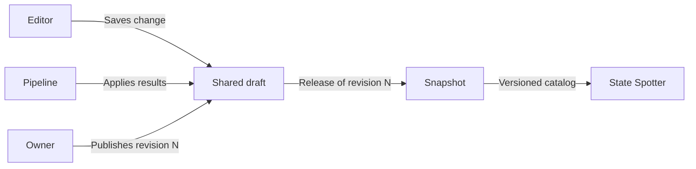

# Plate Curator

**Review and release catalog changes for State Spotter.**

Plate Curator is a web workspace for the license-plate spotting game's catalog. Editors propose changes to tags, images, descriptions, plate families and order in one **shared draft**, and pipeline results land there too. Owners inspect the before-and-after diff at a revision and publish exactly that revision, which creates a versioned catalog snapshot. Changes saved after it stay in the draft.

[Open the app](https://plate-curator-vercel.vercel.app) · [Download the walkthrough](./Plate%20Curator%20-%20Vercel%20Take%20Home%20Walkthrough%20Artifact.html?raw=1) · [Review demo](docs/try-it.md) · [Local setup](#local-setup)

## See it in action

**Start with the walkthrough.** Download the HTML and open it in a browser for the Vercel take-home, including the product tour, architecture and demo. The walkthrough is self-contained.

**Try the app.** Sign-in is invite-only. Demo reviewers receive Editor and Owner credentials privately. Follow the [reviewer guide](docs/try-it.md) to make Alaska changes as an Editor, see them in Review, and inspect Publish as an Owner. The walkthrough stops at inspection.

## What you can do

| In Plate Curator | What it gives you |
| --- | --- |
| **Dashboard** | Browse plates by jurisdiction, group variants into families, edit catalog fields and arrange the state order. Editors can do this without a writable game checkout. |
| **Plate Pipeline** | Run tagging, research, image and grouping tasks. Results enter the review flow as suggestions or draft changes. Configured stages can use a desktop worker or hosted execution. |
| **Review** | See every unpublished change in the shared draft against its catalog baseline, with who made it and when. |
| **Publish** | Inspect the draft at its current revision, broken down by state, and its publication status. An Owner's publish ships that revision: it writes an immutable snapshot and advances the catalog pointer that the game reads. |

## How it works



**Next.js on Vercel** serves the workspace and API routes. **Vercel Workflows** keep Publish and pipeline coordination durable across requests. **Firebase Auth and Firestore** handle membership, drafts and job state, and **Cloud Storage** holds the versioned snapshots. **Ollama** can use a desktop GPU for configured stages, while **Vercel AI Gateway and Eve** support hosted tagging and research.

## Local setup

### Run the checks

You need Node.js 24 and npm. These commands use repository fixtures and test doubles and require no staging credentials.

```sh
git clone https://github.com/Memoriuhl/plate-curator-vercel.git
cd plate-curator-vercel
npm ci
npm run verify
```

Use these commands for a production build or an emulator check.

| Command | What it runs |
| --- | --- |
| `CATALOG_SOURCE=fixture npm run build` | Production build against the bundled catalog fixture |
| `npm run test:emulator` | Firestore integration tests in an isolated emulator. Requires Java 21. |

### Run the dashboard with Firebase access

This path requires access to the Vercel project's Preview environment and an invited Firebase account. Link the checkout to that project with the Vercel CLI, then run the following commands.

```sh
vercel env pull .env.local --environment=preview
npm run dev
```

Open [localhost:3000](http://localhost:3000). The [Firebase access guide](docs/access.md) explains the browser settings, staging targets and short-lived credentials. The [reviewer guide](docs/try-it.md) covers signing in and running the review loop.

For local Workflow debugging, run `npm run workflow:inspect` in the same checkout as the dev server. It opens the inspector at [localhost:3456](http://localhost:3456). Set `WORKFLOW_WEB_PORT` in `.env.local` if you run multiple inspectors.

## Development notes

Run `npm run verify` before submitting changes. The repository’s self-hosted GitHub Actions jobs run only in private mode. Maintainers can enable the local hygiene hooks with `git config core.hooksPath .githooks`.

## Go deeper

- [Product and design spec](docs/spec.md) explains the catalog, roles and review model.
- [Hosted research demo](docs/eve-pipeline-demo.md) explains the Eve path and how to read its evidence.
- [Publish controls and recovery](docs/publish-recovery.md) covers publish receipts, retries and recovery.
