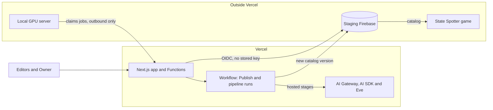

# Plate Curator

**Fix the State Spotter catalog together, and ship exactly what the Owner approves.**

Plate Curator is the web workspace behind State Spotter, a mobile license-plate spotting game. Editors correct plates in one shared draft: tags, images, descriptions, plate families and state order. AI pipeline results land in the same draft. The Owner reviews every change with the name of the person who made it, then publishes an exact revision as a new catalog version that the game picks up.

The workspace runs on Vercel. The game, its Firebase catalog and the local GPU server stay where they are.

[Open the app](https://plate-curator-vercel.vercel.app) · [Read the write-up](./docs/take-home/part-1.html?raw=1) · [Try the review demo](docs/try-it.md) · [Find your way around](#where-to-go)

## Why it exists

State Spotter's catalog holds 8,325 plates and keeps growing, with plates from Europe and Mexico planned. Two things held the team back:

- **Pipeline runs took days.** One desktop GPU ran every AI stage, one plate at a time. A Tag pass over the whole catalog takes about 19 hours, and the next batch waited in line.
- **Review ran on one shared login.** Changes had no author, so the founder rechecked everything before it shipped.

Plate Curator gives each person their own account and role, keeps every change named in one review, and lets pipeline stages run on hosted models through AI Gateway, so a batch no longer waits on one machine.

**Read more:**

- [Write-up, part 1](./docs/take-home/part-1.html?raw=1): the problem, where Vercel fits and the migration plan. Download the HTML and open it in a browser; it is self-contained.
- [Full walkthrough](./Plate%20Curator%20-%20Vercel%20Take%20Home%20Walkthrough%20Artifact.html?raw=1): the demo, results, risks and development tooling.

## What you can do

| Page | What it's for | Who |
| --- | --- | --- |
| **Dashboard** | Browse plates by state, group variants into families, fix tags and fields, and set the state order. | Editors and the Owner |
| **Plate Pipeline** | Run Tag, Research, image and grouping stages on a selection, on the local GPU server or on hosted models. Results land in the draft or as suggestions to accept. | Editors and the Owner |
| **Review** | See every unpublished change in the shared draft against its catalog baseline, with who made it. | Editors and the Owner |
| **Publish** | Inspect the draft at its current revision, broken down by state, then publish that revision. Publishing writes an immutable snapshot and advances the catalog version the game reads. Changes saved afterwards stay in the draft. | Owner |
| **Members** | Invite people and set their role. Sign-in is invite-only. | Owner |

## How it works



- **Next.js and Vercel Functions** serve the workspace. Each API route under `app/api/` runs as a Function.
- **Vercel OIDC** gives each Function a short-lived token that Google trades for Firebase access, so the project stores no service-account key. See [Access](docs/access.md).
- **Workflow** runs Publish and pipeline runs as durable, retried steps, so a run isn't tied to a single request.
- **AI Gateway and the AI SDK** run hosted Tag and Research stages. **Eve** hosts the research agent.
- **Firebase** keeps members, the shared draft, jobs and the published catalog. Cloud Storage holds the catalog snapshots.
- **The local GPU server** runs Ollama models for the stages that stay local. It connects out to the dashboard to claim jobs, so the dashboard never needs a way in.

## Where to go

| I want to… | Start here |
| --- | --- |
| Try the app as a reviewer | [Reviewer guide](docs/try-it.md) |
| Understand the catalog, roles and review model | [Product and design spec](docs/spec.md) |
| See why it's built this way on Vercel | [Write-up, part 1](./docs/take-home/part-1.html?raw=1) and [Access](docs/access.md) |
| Run it on my machine | [Run it locally](#run-it-locally) |
| Change a screen | `app/(curator)/` and `components/`, following the [design system](design-system/README.md) |
| Work on Publish | `workflows/approval.ts`, `lib/publish/` and [Publish controls and recovery](docs/publish-recovery.md) |
| Work on the AI pipeline | `lib/jobs/` (queue), `workflows/`, `worker/` (local GPU), [Research](docs/research.md) and the [hosted research demo](docs/eve-pipeline-demo.md) |
| Work on live updates | `lib/live/` and [Live updates](docs/live-updates.md) |
| Find past decisions | [Decisions](notes/decisions.md), [UI decisions](notes/ui-decisions.md) and [Architecture notes per screen](docs/design/architecture-notes.md) |

### Repository layout

| Folder | What's in it |
| --- | --- |
| `app/` | Next.js App Router. Curator pages are under `(curator)/`, alongside sign-in, invites and the API routes under `api/`. |
| `components/` | UI grouped by feature (dashboard, plate page, review, publish, research, members), with shared primitives in `ui/`. |
| `lib/` | Logic by domain: `auth`, `catalog`, `jobs` (the pipeline queue), `publish`, `review`, `research`, `tagging`, `live`, `members`, `models`, and `gcp` for OIDC credentials. |
| `workflows/` | Durable Workflows: Publish, pipeline runs, tagging, research and catalog push. |
| `worker/` | The local GPU worker, which claims jobs and runs Ollama models, plus evaluation and benchmark tools. |
| `agent/` | The Eve research agent: instructions, tools and channels. |
| `design-system/` | Interstate, the shared design language with the game: tokens, principles, components and screens. |
| `docs/` | Guides for access, the reviewer demo, Publish recovery, research and live updates, plus benchmarks and the take-home write-up. |
| `tests/`, `tests-emulator/` | Unit and component tests, and Firestore integration tests that run in the emulator. |
| `scripts/` | Seed, migration and measurement scripts, plus repository hygiene checks. |
| `fixtures/`, `eval-results/` | Catalog fixtures for offline builds and tests, and tagging evaluation reports. |

## Run it locally

### Run the checks

You need Node.js 24 and npm. These commands use repository fixtures and test doubles and require no staging credentials.

```sh
git clone https://github.com/Memoriuhl/plate-curator-vercel.git
cd plate-curator-vercel
npm ci
npm run verify
```

Use these commands for a production build or an emulator check.

| Command | What it runs |
| --- | --- |
| `CATALOG_SOURCE=fixture npm run build` | Production build against the bundled catalog fixture |
| `npm run test:emulator` | Firestore integration tests in an isolated emulator. Requires Java 21. |

### Run the dashboard with Firebase access

This path requires access to the Vercel project's Preview environment and an invited Firebase account. Link the checkout to that project with the Vercel CLI, then run the following commands.

```sh
vercel env pull .env.local --environment=preview
npm run dev
```

Open [localhost:3000](http://localhost:3000). The [Firebase access guide](docs/access.md) explains the browser settings, staging targets and short-lived credentials. The [reviewer guide](docs/try-it.md) covers signing in and running the review loop.

For local Workflow debugging, run `npm run workflow:inspect` in the same checkout as the dev server. It opens the inspector at [localhost:3456](http://localhost:3456). Set `WORKFLOW_WEB_PORT` in `.env.local` if you run multiple inspectors.

To run pipeline jobs on your own GPU, start the worker with `npm run worker`. Its settings (the dashboard origin, a worker token, the Ollama URL and the model) are read in `worker/main.ts` and `worker/local.ts`.

## Contributing

Run `npm run verify` before opening a pull request; CI runs the same checks. The repository's self-hosted GitHub Actions jobs run only in private mode. Maintainers can enable the local hygiene hooks with `git config core.hooksPath .githooks`.
